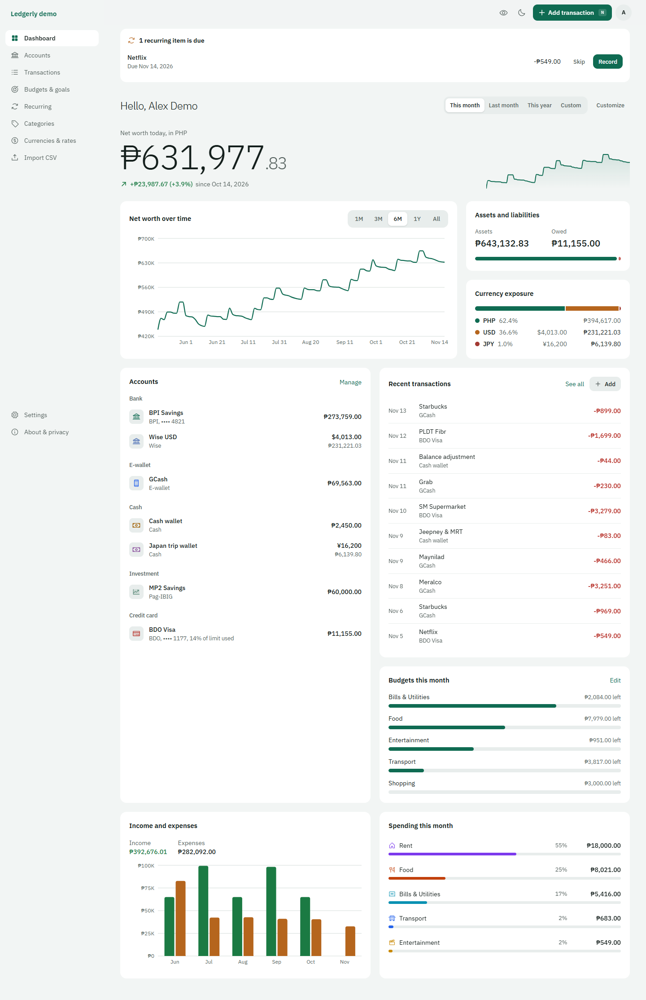

<p align="center"></p>

# My Ledger App (Ledgerly)

A private, offline money tracker for you and up to two other people at home. Everything stays
on your own computer: no accounts with outside services, no internet connection needed, nothing
uploaded anywhere.



- Track bank accounts, e-wallets, cash, credit cards, loans and investments, each in its own currency
- See your net worth, spending by category, income vs. expenses and how it changes over time
- Budgets, savings goals and reminders for regular bills
- Import statements from your bank as CSV, export your records any time
- Light and dark mode, seven colour themes, a "hide amounts" switch for screen sharing
- Optional: let family use it from their phones on your home Wi-Fi

## Download

**[Download the latest version](../../releases/latest)**, the file named `Ledgerly-<version>.zip`.

Only the ready-to-run app is published here.

## Install on Windows

1. Unzip the download anywhere, for example in Documents.
2. Double-click **Ledgerly.exe**.
3. If Windows says **"Windows protected your PC"**, click **More info**, then **Run anyway**.
   This appears because the app isn't signed with a paid certificate.
4. Your browser opens the app. Create your admin account and you're ready.

A Ledgerly icon appears in the system tray (bottom right, near the clock). Right-click it to
reopen the app, host it on your home network, open the data folder or quit.

**Read `READ ME FIRST.txt` inside the zip** for backups, adding family members, using it from a
phone and what to do if you forget your password.

## Mac and Linux

The zip also contains versions for macOS (Apple Silicon and Intel) and Linux in the
`Other computers` folder, with instructions in `READ ME FIRST.txt`.

## Check your download

Each release lists the SHA-256 fingerprint of its zip, and `SHA256SUMS.txt` inside the zip
lists every file. On Windows, check with:

```powershell
Get-FileHash .\Ledgerly-1.0.2.zip
```

## Privacy

Your data is stored only in `%AppData%\Ledgerly` on the computer that runs the app (on Mac:
`~/Library/Application Support/Ledgerly`). The app makes no internet requests at all. It even
blocks itself from loading anything that isn't on your computer.
